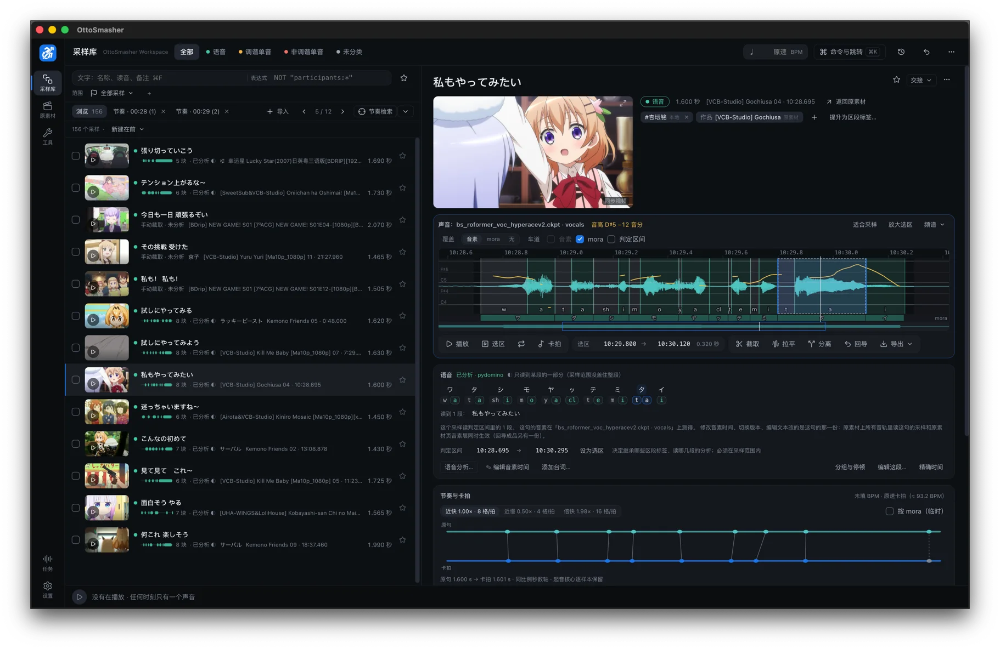
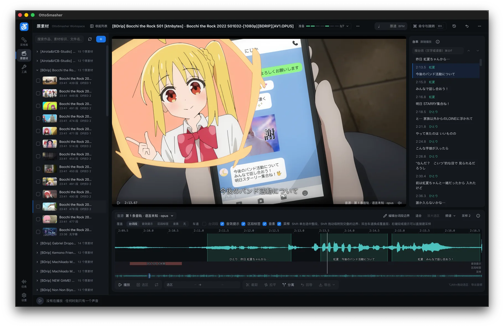
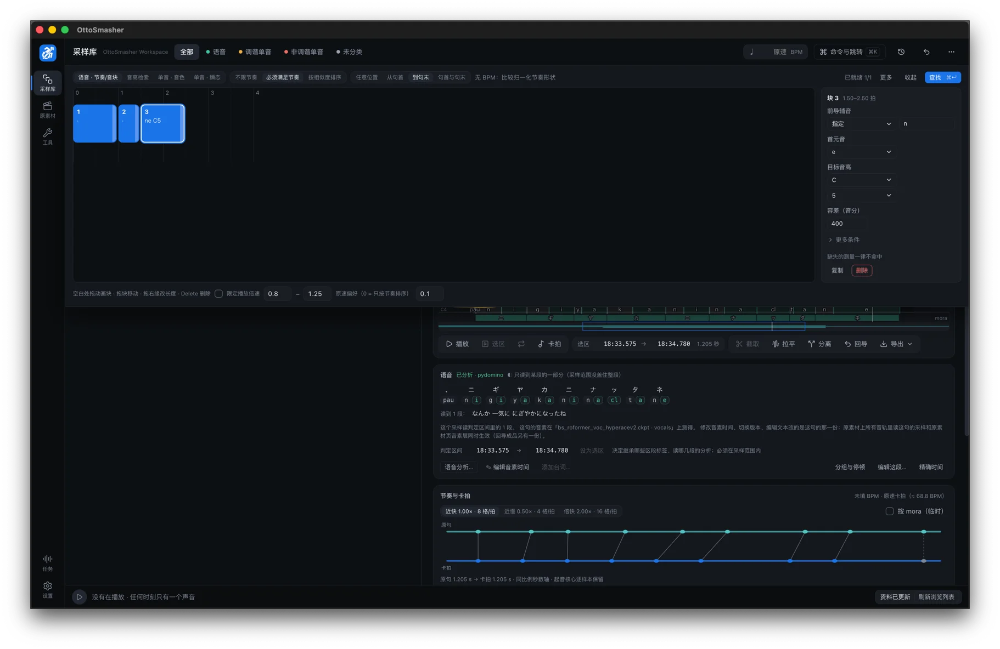
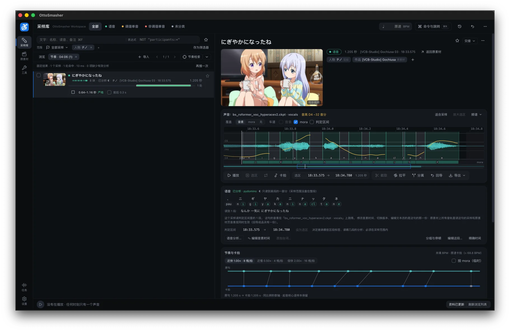
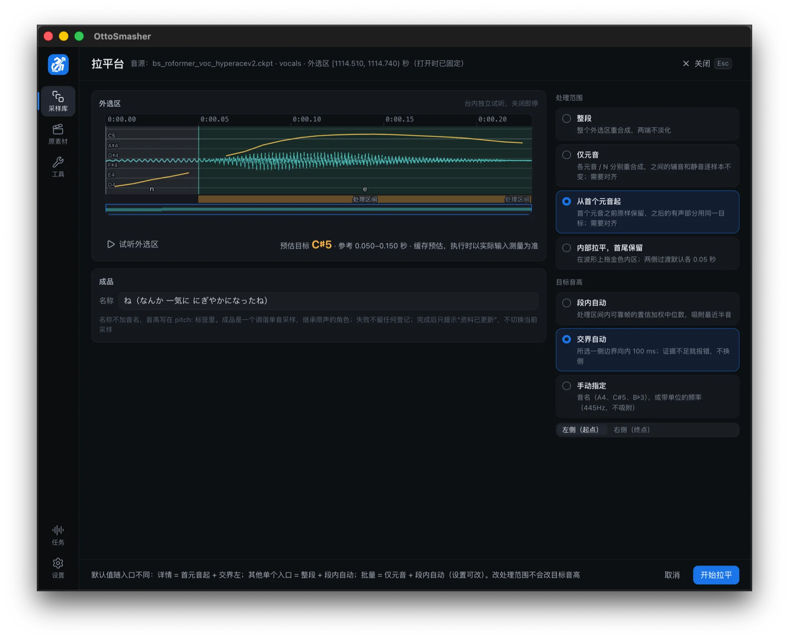
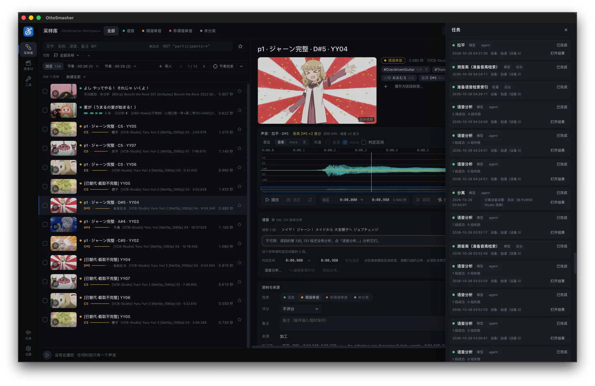

<p align="center">
  
</p>

<h1 align="center">OttoSmasher</h1>

<p align="center">A local workstation for otoMAD material</p>

<p align="center"><a href="README.md">简体中文</a> | English</p>

<p align="center">
  <a href="https://github.com/Axolyz/OttoSmasher/releases"></a>
  <a href="LICENSE"></a>
</p>

OttoSmasher is a workstation for otoMAD material. It keeps lines, samples and sound effects from anime, videos, game voices and sample packs in one place, and handles cutting, vocal separation, flattening and beat-fitting. You can search the whole library by rhythm or pitch, then hand the results to a DAW or video editor. Agents such as Claude Code and Codex can also operate it from the command line, for work that needs judgement, such as cleaning subtitles, picking lines and choosing timbres. Without an agent, it is still a complete material workstation.

OttoSmasher does not generate music or create on your behalf. It cuts the repetitive work in processing and managing material; what to choose, how to arrange it and what to express stay with you.

**The project is at an early stage, so expect bugs and rough edges.**

Download: [Releases](https://github.com/Axolyz/OttoSmasher/releases) (macOS on Apple silicon, Windows 10 / 11 x64). See [Installation](#installation) for the steps.

The user documentation is currently in Chinese only. The interface is available in English.

<table>
  <tr>
    <td width="50%"></td>
    <td width="50%"></td>
  </tr>
</table>

## Recommended workflow

For speech material such as anime and voiced videos, we recommend:

0. (Optional) Have an agent follow the built-in skill to [prepare subtitles](docs/user/how-to.md#预处理字幕): clean, retime, split where needed, and label speakers. Skip this if your subtitles are already prepared
1. Organize the material into one folder per work, with a same-name subtitle file next to each video (see [folders and subtitle format](docs/user/reference.md), in Chinese)
2. Register the folder in OttoSmasher. Same-name subtitles are linked automatically; import them with one more click
3. Separate the vocals and set them as the default vocal track (requires PyMSS Studio and a manually downloaded model). If you skip this on material with background sound, speech analysis will be largely unusable
4. Create samples from the lines in bulk and run speech analysis
5. Search samples by rhythm or pitch, and audition beat-fits at your BPM
6. Copy the results to REAPER, or export WAV files and video clips

OttoSmasher also supports other ways of working:

1. Review a source and hand-pick the lines you like, without creating samples in bulk
2. Material without separated vocals or subtitles, or in languages other than Japanese, can still be cut, separated, flattened and searched by pitch
3. Import game voice packs, sample packs and instrument one-shots, and filter them by pitch, transient or timbre

For a first run, follow the [tutorial](docs/user/tutorial.md) (in Chinese). The full documentation is in the [user guide](docs/user/README.md) (in Chinese).

## Using it with agents

Agents that can run commands on your computer, such as Claude Code and Codex, can operate OttoSmasher through the `otto` command line, using the same functions as the interface. The app does the deterministic work: storing data, separation, analysis, search and export. Work that needs judgement can go to the agent: cleaning subtitles, retiming, picking lines, choosing timbres. The agent can also propose arrangements, but for now we recommend it for upstream material work, and leaving choices and creation to people.

macOS is the recommended operating system for agent integration, with fewer setup issues in the author’s experience; Windows is also supported. On Windows, many agent hosts need Full Access to connect to Otto through the current local IPC setup.

Codex (sandbox) + GPT 6.1 Sol is the author’s recommended setup and the one used in practice. For Chinese models, use a coding agent with a model at least around the capability of DeepSeek v4 flash or GLM 5.3 Flash. DeepSeek Harness with Full Access works well for basic tasks, but complex subtitle preparation and sample selection remain inconsistent; the author has found DeepSeek’s instruction following particularly poor despite a round of targeted improvements.

Send your agent one of these messages, followed by your task.

To work with the app and its library:

```
Please operate OttoSmasher on my computer with its command line otto: first run otto status and otto guide; if the app is not open, run otto open.
Task: ...
```

For subtitle preparation, follow the opening with:

```
Please follow the preparing-subtitles skill to prepare subtitles in [file or material folder]. Use subtitles from [subtitle path] and align them to [target video].
```

For audio computation only, without touching the library:

```
Please do an audio computation with the otto command line; if the app is not open, run otto open.
Use only the primitives: find commands with otto commands --layer primitive, and read otto guide primitives for usage. Do not read or write the library, and skip the other documentation.
Task: ...
```

- **Open capabilities, no fixed pipeline**: phoneme alignment, reading analysis, pitch measurement, search, separation and flattening are independent capabilities. The app itself only does deterministic computation; the agent organizes the work from context and can script batch calls.
- **Data managed by the app**: sources, tracks, lines, phonemes, samples and tags live in a structured library. The agent queries what it needs, without filling its context or managing piles of files.
- **Review and undo**: the agent's data edits are recorded by session. You can review them in the app's history and undo a whole session. New samples and tracks cannot be undone, but they can be deleted.
- **Hearing sound**: with the audio tool audio-mcp connected, the agent can view spectrograms, measure loudness and make timed transcripts.
- **Preprocessing and complex speech analysis**: preprocessing that later steps depend on, such as cleaning subtitles, retiming and grouping lines by speaker, comes with built-in skills based on methods the author worked out. They are files in your workspace, so you can edit them or add your own.

See [Using agents with OttoSmasher](docs/user/agents.md) (in Chinese) for details.

## Features

### Cut while you watch

You can select a range on the timeline during playback, or create a sample directly from a line in the script. Lines can be searched by text or reading, across episodes. Every sample remembers where it came from, so you can always go back to the source for context.

### Creating samples in bulk

You can turn a whole season of lines into samples at once, or create samples in bulk from sound hints or whole files. Lines inside the OP and ED are skipped automatically. A sample only records a range on a track and creates no new file, so even large numbers of samples take little extra space.

### Speech analysis

Turns Japanese lines into phonemes and readings, then finds the time range of each phoneme in the audio, which is usually called phoneme alignment. Wrong readings can be corrected in the user dictionary, and inaccurate boundaries can be fixed by hand.

### Beat-fit

Beat-fit nudges the rhythm of the original speech onto a BPM grid, while keeping as much of its natural rhythm as possible and avoiding distortion. Roughly, it works like this:

1. From the phoneme alignment, it measures the time from each block's onset (a block is one vowel or moraic nasal) to the next, then normalizes those durations to small integer ratios (parameters can favor smaller ratios).
2. When placing them on the BPM grid, it picks the density closest to the original speaking rate, to avoid heavy stretching that would change the overall speed of the source.
3. Up to 8 ms around each onset is kept as it is, so articulation and attacks stay crisp. The audio between onsets is stretched with Rubber Band R3, preserving pitch.
4. Pauses inside the line absorb the extra time first.

You can audition different densities for each line and adjust how many cells each block takes. With no BPM set, lines are fitted at their original speaking rate.

### Rhythm search

Draw a row of blocks, optionally specify the vowel, consonant, pitch and loudness of each, and search the whole library for matching samples. Hits can be auditioned as beat-fits straight away, exported or copied to REAPER.

| Draw blocks and set conditions | See where hits are and how well they match |
|---|---|
|  |  |

### Pitch search

Draw a few pitch blocks and find passages in samples or whole tracks that hit exactly those notes, optionally ignoring the octave. This helps with pitch-matched otoMAD work.

### Export

You can export WAV files of the original or the beat-fit, or drag WAV files from the library straight into a DAW. Sound processed elsewhere with more elaborate methods can be put back in its original place (reimport). It becomes a new track and stays connected to the original picture and tags.

### Copy to REAPER

Press Ctrl+C / ⌘C on a sample and paste it into REAPER. Every onset already has a stretch marker, so you do not have to find onsets and place markers by hand, and you can drag the markers straight away.

There are two modes:

- Beat-fit: the pasted item's stretch markers are already set the way beat-fit would set them. With a matching BPM, the markers also land exactly on a multiple of the REAPER BPM grid, ready for further editing. Deleting all the markers brings back the original sound.
- Original: stretch markers only mark each onset and the original rhythm stays as it is, ready for fitting by hand.

When you copy several samples, they are laid out one after another on the same track, with one bar between them.

### Vocal separation and other PyMSS model processing

Uses PyMSS Studio, installed separately, to separate whole episodes or selected passages. Download the models in Studio beforehand. For ordinary anime and video, the author recommends HyperACE v2 (`bs_roformer_voc_hyperacev2`), a stable, fast community baseline; for songs, Becruily deux (`becruily_deux`) retains more high-frequency vocals at the cost of some noise. Results become named tracks on the source. Set a vocal track as the default to use it for subsequent samples and speech analysis.

This entry can also call other models installed in PyMSS to process audio and keep their outputs as named tracks.

### Flatten

Flattens the pitch of a stretch of speech onto one note, keeping the words, and resynthesizes it with the PC-NSF-HiFiGAN vocoder. You can process the whole range, only the vowels, everything from the first vowel, or just the middle while keeping both ends. The target pitch can be automatic or set by hand. The result is a new track, plus a sample with a definite pitch.

| Flatten: choose the range and target pitch | Task drawer: analysis, separation and flattening queue in the background |
|---|---|
|  |  |

### Organizing samples

Tags can be inherited automatically from the work, subtitle speakers and range tags, or added by hand. You can use stars and tag expressions, filter by work, person, pitch and more, and save common conditions as filters. Batch edits show a before-and-after comparison first, and data edits can be undone.

### Sample packs and one-shots

Sample packs and instrument one-shots can be turned into samples in bulk. Those with a definite pitch can be searched by note name, and percussion and sound effects can be filtered by attack time, brightness, noisiness and other measures (one-shot filtering is experimental, and results may be poor; agent access is currently recommended).

### Independence

Saves the samples you want to keep as lossless slices, and their pictures as video clips. Even after the whole source is deleted, those samples can still be played, exported and read their speech analysis, but you can no longer go back to the source for context.

### Human VOCALOID workflow

The project is mature enough that cutting and assembling phonemes in bulk, and even semi-automatic UTAU voicebank creation, should be easy to build. But the developer does not know the human VOCALOID workflow well enough to know how it should work in the app. If you are an otoMAD creator who knows this workflow, ideas are very welcome.

## System requirements

| | |
|---|---|
| System | macOS 15 or later (Apple silicon); Windows 10 / 11 x64 (with DirectML GPU acceleration, or CPU without a discrete GPU) |
| Disk | About 1.2 GB for the app, including models; about 4 GB of workspace data at around 4000 samples, not counting the sources |
| Language | The interface is in Simplified Chinese and English; speech analysis supports Japanese only for now |
| Vocal separation | Requires [PyMSS Studio](https://github.com/pymss-project/pymss-studio/releases) |

## Installation

### macOS

1. Download `OttoSmasher-<version>-macos-arm64.zip` from [Releases](https://github.com/Axolyz/OttoSmasher/releases) and check the SHA-256 in the release notes:
   ```
   shasum -a 256 OttoSmasher-*.zip
   ```
2. Unzip it and drag `OttoSmasher.app` into Applications.
3. Before opening it for the first time, run this in Terminal:
   ```
   xattr -dr com.apple.quarantine /Applications/OttoSmasher.app
   ```
   The app is not notarized by Apple, so macOS blocks it unless you run this command. Run it again after each new download. You can also go to System Settings → Privacy & Security after it is blocked and click Open Anyway.

### Windows

1. Download `OttoSmasher-<version>-windows-x64.zip` from [Releases](https://github.com/Axolyz/OttoSmasher/releases) and check the SHA-256 with `Get-FileHash OttoSmasher-*.zip`.
2. Unzip it to any folder and run `OttoSmasher.exe`. The package is not signed, so when SmartScreen blocks it, click More info → Run anyway.

## FAQ

### Where is my data stored?

In the workspace, by default `OttoSmasher Workspace` under Documents. Generated tracks and exports are in its `Library/` folder.

### Will updating lose my data?

No. Replacing the app does not touch the workspace. When a new version needs to upgrade the database, it first makes a backup in `Data/Backups/`.

### Does it copy or change my source files?

No. OttoSmasher only records where sources are, and it does not delete the original files on disk.

### Does it need an internet connection?

The app itself does not. Release builds include all their models; separation models are downloaded by PyMSS Studio. If you connect an agent that uses a cloud model, the lines and audio it reads may be uploaded. Whether to work that way is your decision.

### Can I use it without separated vocals, without subtitles, or with material that is not in Japanese?

Yes. The basic features are not affected: registering and playback, cutting on the timeline, vocal separation, flattening a whole range, pitch search, tagging, and exporting WAV files and video clips.

But many advanced features depend on clean vocals and phoneme alignment, and the impact can be large:

| Situation | What is affected |
|---|---|
| No separated vocals | Speech analysis can run on the original mix, but with background music or effects the phoneme alignment error rate rises sharply and the results are largely unusable. Beat-fit, rhythm search and REAPER stretch markers are built on the alignment, so they go wrong with it. Pitch measurement is also easily disturbed by accompaniment, which affects pitch search and automatic target pitch. Agent retiming, splitting multi-speaker subtitles and voiceprint grouping need clean vocals too. Material that is already dry, such as game voices, does not need separating. |
| No subtitles | Without lines, you cannot create samples from lines, search lines or filter by person, and speech analysis is not possible. That rules out beat-fit, rhythm search, REAPER stretch markers and flattening only the vowels. You can type lines by hand or have an agent generate subtitles with speech recognition. Machine transcripts contain errors and their timing can drift, so important lines need fixing by hand. |
| Not in Japanese | Subtitles can be imported, searched by text and used to create samples in bulk. But speech analysis only supports Japanese for now, so beat-fit, rhythm search, REAPER stretch markers and flattening only the vowels are not available. Agents cannot use the app's alignment and reading analysis either. |

## Known issues

- Some restricted agent sandboxes on Windows, such as DeepSeek Harness, block local named-pipe connections with Access denied. For LLM agents other than Codex, the current recommendation is to enable **Full Access** in the host.
- The first audio-mcp transcription downloads a model (turbo is about 1.6 GB) and needs a suitable network connection. Long CPU transcription can be slow; extracting short clips first helps.
- On Windows, release Alt before dropping into File Explorer.
- When you drag a WAV into a DAW on macOS, the receiving app may read `が` as `か` followed by a combining dakuten if it uses the system’s file path conversion. The WAV filename exported by OttoSmasher keeps the composed form. What you see depends on the receiving app.
- See the [roadmap](docs/ROADMAP.md) for the remaining issues.
- The skills are still being refined. The author mainly uses and recommends macOS + Codex (sandbox) + GPT 6.1 Sol. On Windows, DeepSeek Harness with Full Access works well for basic tasks; complex work such as subtitle preparation and sample selection, which combines tools and content judgement, still needs improvement.

## Feedback

Please [open an issue](https://github.com/Axolyz/OttoSmasher/issues) for problems and suggestions, with your system version, steps to reproduce, and the relevant logs from `Data/Logs/` in your workspace.

## Acknowledgements

This project uses [pydomino](https://github.com/DwangoMediaVillage/pydomino), [pyopenjtalk-plus](https://github.com/tsukumijima/pyopenjtalk-plus), [tsqyomi](https://huggingface.co/tsukumijima/tsqyomi-models), [FCPE](https://github.com/CNChTu/FCPE), [HiFiShifter](https://github.com/ARounder-183/HiFiShifter), PC-NSF-HiFiGAN from [OpenVPI](https://github.com/openvpi), [Rubber Band](https://breakfastquay.com/rubberband/), [mpv](https://mpv.io/), [FFmpeg](https://ffmpeg.org/), [ONNX Runtime](https://onnxruntime.ai/), [Electron](https://www.electronjs.org/), [React Aria](https://react-spectrum.adobe.com/react-aria/) and [PyMSS Studio](https://github.com/pymss-project/pymss-studio). The full list and their licenses are in [THIRD_PARTY.md](docs/THIRD_PARTY.md).

## License

OttoSmasher is released under [GPL-3.0-or-later](LICENSE). You may use, modify and redistribute it freely; redistribution must also be under the GPL with source code. This program comes with no warranty.

- Bundled third-party components have their own licenses; the files are in `licenses/` in the release package.
- Model weights are separate components. The alignment, reading prediction and pitch models are MIT. The flatten vocoder PC-NSF-HiFiGAN is CC BY-NC-SA 4.0, for non-commercial use only; delete `Contents/Resources/models/flatten/` before commercial redistribution.

## Development

This section is for developers; regular users can skip it. These documents are in Chinese.

- Running from source, testing, packaging: [DEVELOPMENT.md](docs/DEVELOPMENT.md)
- Development rules, for people and AI agents: [AGENTS.md](AGENTS.md)
- System structure: [ARCHITECTURE.md](docs/ARCHITECTURE.md)
- Current decisions: [DECISIONS.md](docs/DECISIONS.md)
- Plans: [ROADMAP.md](docs/ROADMAP.md)

## Friends

- [HiFiShifter](https://github.com/ARounder-183/HiFiShifter) (a friendly nudge here for its stretch marker feature; we will support it as soon as it lands)
- [HachiShifter](https://github.com/openhachimi/HachiShifter) (future support for the human VOCALOID workflow will target this project first)
