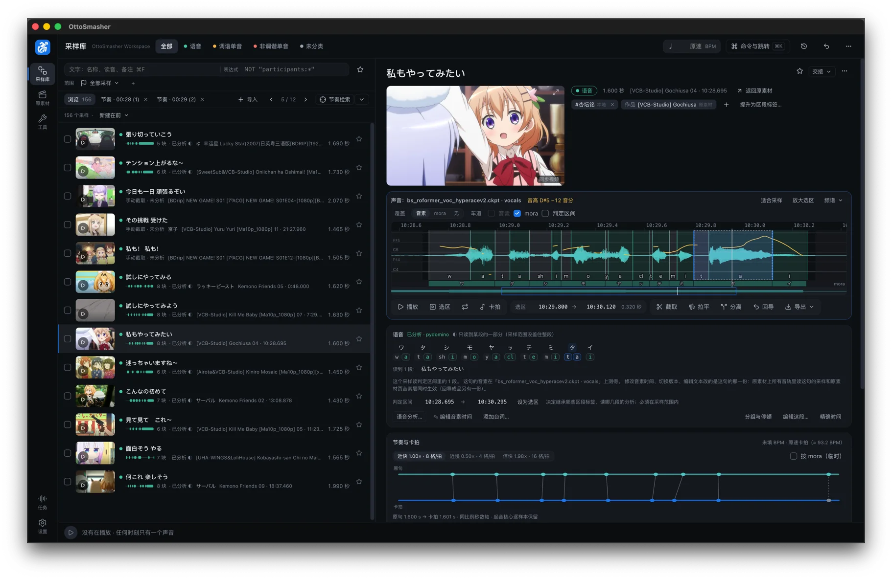
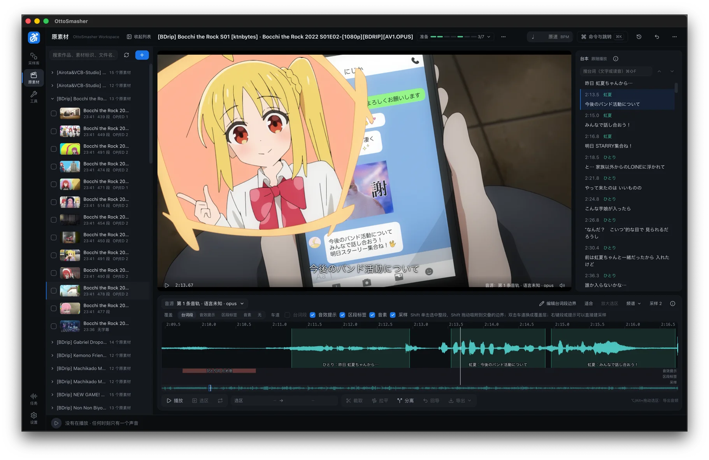
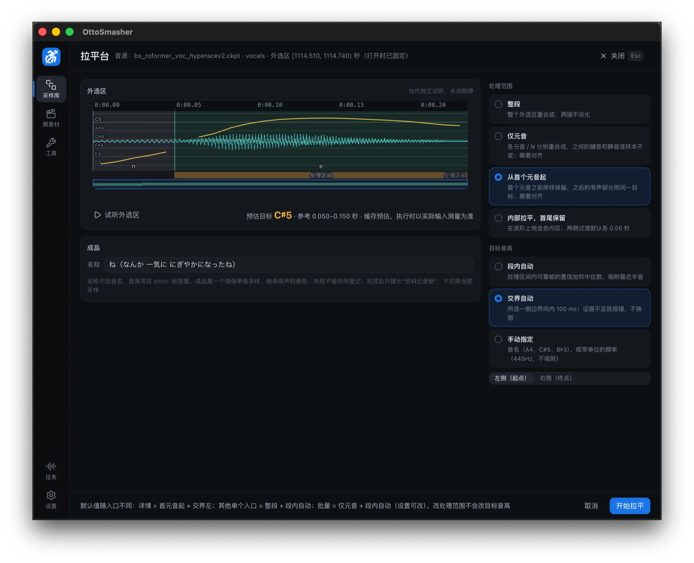
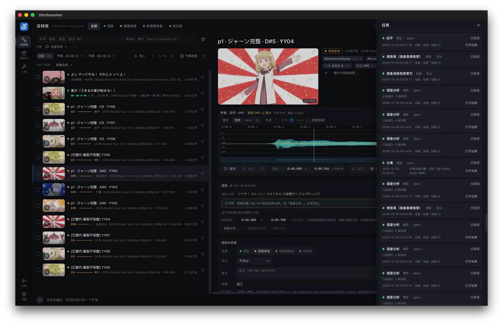
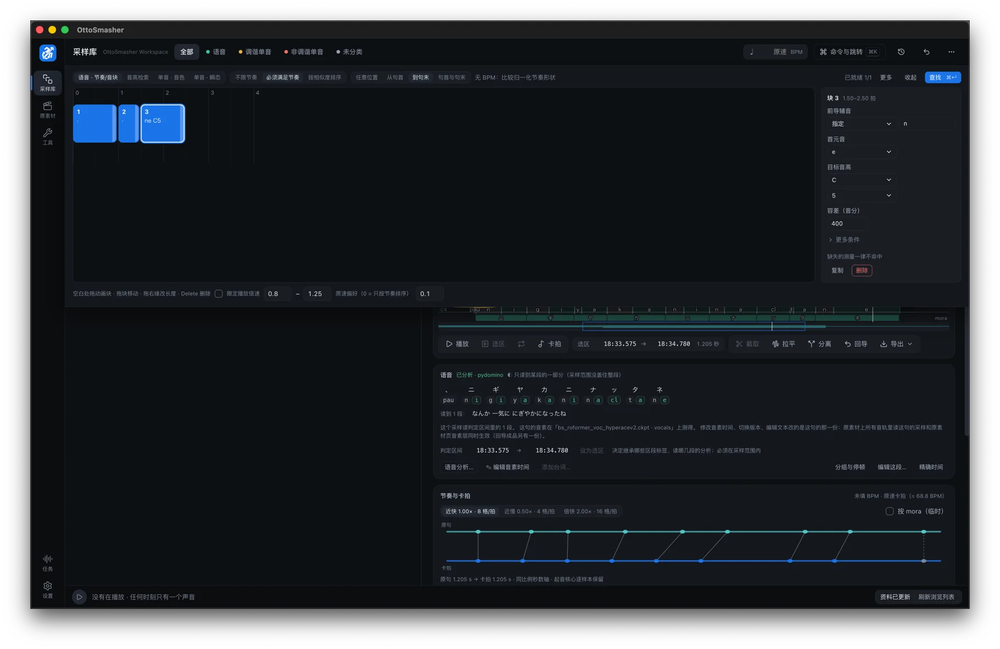
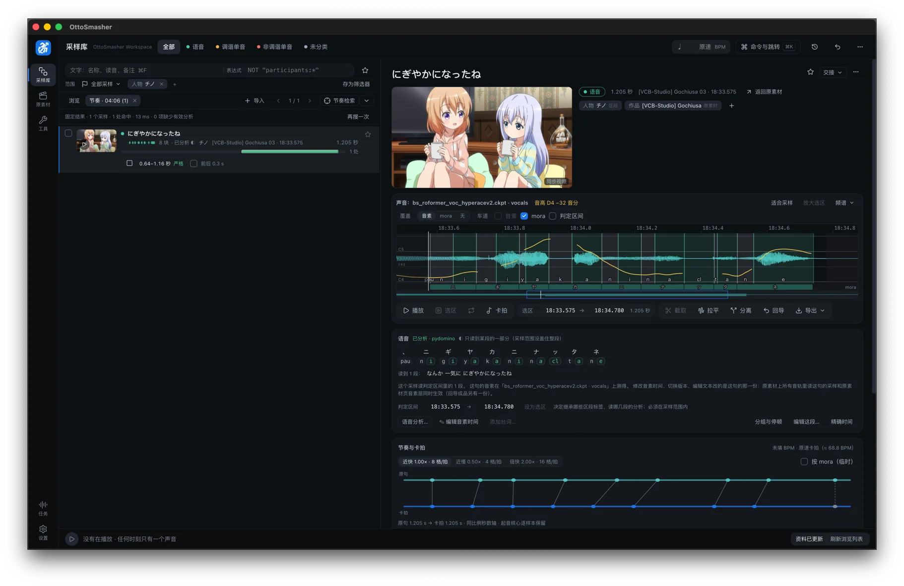

<p align="center">
  
</p>

<h1 align="center">OttoSmasher</h1>

<p align="center">A local workstation for otoMAD material</p>

<p align="center"><a href="README.md">简体中文</a> | English</p>

<p align="center">
  <a href="https://github.com/Axolyz/OttoSmasher/releases"></a>
  <a href="LICENSE"></a>
</p>

OttoSmasher is a workstation for otoMAD material. It keeps lines, samples and sound effects from anime, videos, game voices and sample packs in one place, and handles cutting, vocal separation, flattening and beat-fitting. You can search the whole library by rhythm or pitch, then hand the results to a DAW or video editor. Agents such as Claude Code and Codex can also operate it from the command line, for work that needs judgement, such as cleaning subtitles, picking lines and choosing timbres. Without an agent, it is still a complete material workstation.

You can turn a whole season of dialogue into samples in one batch. Each sample simply points to a range on its source track. For your next project, search the same library by character, dialogue, rhythm or pitch. Jump back to the source to hear a line in context, and use the same sample in multiple projects.

OttoSmasher does not generate music or create on your behalf. It cuts the repetitive work in processing and managing material; what to choose, how to arrange it and what to express stay with you.

**The project is at an early stage, so expect bugs and rough edges.**

Download: [Releases](https://github.com/Axolyz/OttoSmasher/releases) (macOS on Apple silicon, Windows 10 / 11 x64). See [Installation](#installation) for the steps.

The user documentation is currently in Chinese only. The interface is available in English.

<table>
  <tr>
    <td width="50%"></td>
    <td width="50%"></td>
  </tr>
</table>

## Recommended workflow

For speech material such as anime and voiced videos, we recommend:

0. If your subtitles are not ready, [prepare them first](docs/user/how-to.md#预处理字幕) (guide in Chinese)
1. Organize the material into one folder per work, with a same-name subtitle file next to each video (see [folders and subtitle format](docs/user/reference.md), in Chinese)
2. Register the folder in OttoSmasher. Same-name subtitles are linked automatically; import them with one more click
3. Separate the vocals and set them as the default vocal track (requires PyMSS Studio and a manually downloaded model). If you skip this on material with background sound, speech analysis will be largely unusable
4. Create samples from the lines in bulk and run speech analysis
5. Search samples by rhythm or pitch, and audition beat-fits at your BPM
6. Copy the results to REAPER, or export WAV files and video clips

OttoSmasher also supports other ways of working:

1. Review a source and hand-pick the lines you like, without creating samples in bulk
2. Material without separated vocals or [subtitles](docs/user/how-to.md#处理没有字幕的视频), or in languages other than Japanese, can still be cut, separated, flattened and searched by pitch
3. Import game voice packs, sample packs and instrument one-shots, and filter them by pitch, transient or timbre

For a first run, follow the [tutorial](docs/user/tutorial.md) (in Chinese). The full documentation is in the [user guide](docs/user/README.md) (in Chinese).

Want help from an agent? See the [OttoSmasher harness](#using-llm-agents-with-the-ottosmasher-harness).

## Features

### Browse your sources

Import dialogue timings and optional speaker labels from subtitles, then jump around the original video from the script. Search by text or reading, including across episodes. After full-source separation, switch to the vocal track or another output, such as the backing track. Turn a line into a sample named after the dialogue.

Make samples from a whole season of dialogue at once, skipping marked openings and endings, or batch-create them from sound hints or whole files.

### Process your material

Run a PyMSS model (for example, to separate vocals), cut a passage, flatten its pitch, or reimport audio. Process the result again to make your own chain. No need to open four hundred apps and kickbox your way through eight hundred exports just to make a sample.

- Samples that retain their source timing stay in sync with the picture. Jump between the sample and its source, see the processing chain, and open related samples.
- Drag samples into a DAW or export original or beat-fitted WAVs. Samples with picture can also be exported as matching video clips.
- Full-source PyMSS outputs behave like tracks on the source. Set the separated vocals as the default vocal track for new dialogue samples and analyze those samples on the clean audio. Separate once and use the result again and again.
- Cutting and creating samples only records ranges, rather than copying the source files for each sample. Separation, flattening and reimport create new audio files. Your disk doesn't have to drown in a pile of clips.
- Want to clear out a whole episode but keep a few samples? [Make them independent](docs/user/how-to.md#省磁盘) by saving only the lossless audio slices and video clips you need. After moving the original out of the library, you can still audition and export those samples, but you can't jump back to the original scene.
- Flatten just the vowels, or flatten the middle and leave both ends alone. You can also pick the target note by hand.

| Flatten: choose the range and target pitch | Task drawer: analysis, separation and flattening queue in the background |
|---|---|
|  |  |

### Organize samples with tags

Keep samples in one library and see the synchronized picture where available. No more digging through a pile of mystery files and intermediate exports.

- Samples can inherit tags from the work, speakers and source ranges. Add your own local tags and stars as you like.
- Filter by the current project to focus on the material it needs. One sample can belong to more than one project.

### Speech analysis

Align Japanese dialogue at the phoneme level. See where each consonant and vowel lands, along with pitch and relative loudness. It powers the block and rhythm searches below. Correct a boundary once and samples of the same line on different tracks share the correction.

### Search for a single sound block

Need a long, pitch-stable “ah” for a lead? Draw one block in Rhythm Search, set the first vowel, minimum original duration and maximum pitch spread, and audition matching analyzed samples.

### Beat-fit

Set a BPM to line up the onsets of vowels or moraic nasals with the beat, then audition or export the result. It tries to preserve the original rhythm.

**REAPER handoff:** Paste analyzed speech with editable stretch markers already on the onsets. Bring in the beat-fit or keep the original timing and just mark the onsets.

### Rhythm search

Draw the rhythm you want on a grid and find lines that can be spoken to it. Specify consonants, vowels, pitch, loudness and more for each block.

| Draw blocks and set conditions | See where hits are and how well they match |
|---|---|
|  |  |

### Pitch search

Find passages that match your notes in the sample library or across a whole track, with or without matching the octave. Especially handy for pitch-matched otoMAD.

### Reimport

If OttoSmasher doesn't do a particular kind of processing, do it elsewhere and put the resulting audio back in its original place. Keep using the original picture and range tags.

### Agent integration and harness

Use OttoSmasher as a material library and toolkit for LLM-assisted otoMAD. The human-in-the-loop CLI and skill harness lets agents call the same business commands as the desktop app as well as standalone audio computations. Ask Codex or Claude Code to find lines, run analysis or pick samples. Results appear in the app for you to audition and take over. Undo supported edits individually or by session; risky operations that can't be undone require your approval by default.

- Built-in skills cover subtitle cleanup, timing and speaker labels. Edit them or put your preferences in the playbook. Connect audio-mcp to let the agent inspect spectrograms, measure loudness and make timed transcripts.
- There's even a just-for-fun **“do it all” mode (都爆模式)** ([`picking-instruments`](docs/user/agents.md#修改-skill-和约定), guide in Chinese): give the agent MIDI and material, and let it find samples and make previews. The results are pretty rough; it's there for fun. The point is to help you create faster, not to create for you.

## Using LLM agents with the OttoSmasher harness

For example, ask an agent to pick a few opening lines for one character across episodes and leave the candidates in the sample library. Revisit the original scenes, audition the candidates, and add your picks to the current project.

macOS is the recommended operating system for agent integration, with fewer setup issues in the author’s experience; Windows is also supported. On Windows, many agent hosts need Full Access to connect to Otto through the current local IPC setup.

Codex (sandbox) + GPT 6.1 Sol is the author’s recommended setup and the one used in practice. For Chinese models, use a coding agent with a model at least around the capability of DeepSeek v4 flash or GLM 5.3 Flash. DeepSeek Harness with Full Access works well for basic tasks, but complex subtitle preparation and sample selection remain inconsistent; the author has found DeepSeek’s instruction following particularly poor despite a round of targeted improvements.

Send this to your agent, followed by your task:

```
Please operate OttoSmasher on my computer with its command line otto: first run otto status and otto guide; if the app is not open, run otto open.
Task: ...
```

To [run audio computations without touching the library](docs/user/agents.md#只做音频计算) or learn more about setup, see [Using agents with OttoSmasher](docs/user/agents.md) (in Chinese).

## System requirements

| | |
|---|---|
| System | macOS 15 or later (Apple silicon); Windows 10 / 11 x64 (with DirectML GPU acceleration, or CPU without a discrete GPU) |
| Disk | About 1.2 GB for the app, including models; about 4 GB of workspace data at around 4000 samples, not counting the sources |
| Language | The interface is in Simplified Chinese and English; speech analysis supports Japanese only for now |
| Vocal separation | Requires a separate PyMSS Studio installation; see [verified versions](#why-install-pymss-studio-separately) |

## Installation

### macOS

1. Download `OttoSmasher-<version>-macos-arm64.zip` from [Releases](https://github.com/Axolyz/OttoSmasher/releases) and check the SHA-256 in the release notes:
   ```
   shasum -a 256 OttoSmasher-*.zip
   ```
2. Unzip it and drag `OttoSmasher.app` into Applications.
3. Before opening it for the first time, run this in Terminal:
   ```
   xattr -dr com.apple.quarantine /Applications/OttoSmasher.app
   ```
   The app is not notarized by Apple, so macOS blocks it unless you run this command. Run it again after each new download. You can also go to System Settings → Privacy & Security after it is blocked and click Open Anyway.

### Windows

1. Download `OttoSmasher-<version>-windows-x64.zip` from [Releases](https://github.com/Axolyz/OttoSmasher/releases) and check the SHA-256 with `Get-FileHash OttoSmasher-*.zip`.
2. Unzip it to any folder and run `OttoSmasher.exe`. The package is not signed, so when SmartScreen blocks it, click More info → Run anyway.

## FAQ

### Where is my data stored?

In the workspace, by default `OttoSmasher Workspace` under Documents. Generated tracks and exports are in its `Library/` folder.

### Will updating lose my data?

No. Replacing the app does not touch the workspace. When a new version needs to upgrade the database, it first makes a backup in `Data/Backups/`.

### Does it copy or change my source files?

No. OttoSmasher only records where sources are, and it does not delete the original files on disk.

### Does it need an internet connection?

The app itself does not. Release builds include the models for built-in features; separation models are downloaded by PyMSS Studio. If you connect an agent that uses a cloud model, the lines and audio it reads may be uploaded. Whether to work that way is your decision.

### Why install PyMSS Studio separately?

**Verified PyMSS Studio versions: [v0.1.0](https://github.com/pymss-project/pymss-studio/releases/tag/v0.1.0) and [v0.1.1](https://github.com/pymss-project/pymss-studio/releases/tag/v0.1.1). Other versions are not guaranteed to work.** See [vocal separation](docs/user/how-to.md#分离人声) for setup and model choices (in Chinese).

Studio's graphical interface makes it easier to download, switch, and manage models. You can choose a model for your material and an inference runtime for your hardware without waiting for an OttoSmasher update.

Vocal separation is compute-intensive and sometimes needs hardware acceleration. Bundling a CUDA-enabled PyTorch runtime would likely push the OttoSmasher release package over 2 GB. Keeping separation in Studio keeps OttoSmasher relatively lightweight, and you can skip installing that runtime if you don't need separation.

### Can I use it without separated vocals, without subtitles, or with material that is not in Japanese?

Yes. The basic features are not affected: registering and playback, cutting on the timeline, vocal separation, flattening a whole range, pitch search, tagging, and exporting WAV files and video clips.

But many advanced features depend on clean vocals and phoneme alignment, and the impact can be large:

| Situation | What is affected |
|---|---|
| No separated vocals | Speech analysis can run on the original mix, but with background music or effects the phoneme alignment error rate rises sharply and the results are largely unusable. Beat-fit, rhythm search and REAPER stretch markers are built on the alignment, so they go wrong with it. Pitch measurement is also easily disturbed by accompaniment, which affects pitch search and automatic target pitch. Agent retiming, splitting multi-speaker subtitles and voiceprint grouping need clean vocals too. Material that is already dry, such as game voices, does not need separating. |
| No subtitles | Without lines, you cannot create samples from lines, search lines or filter by person, and speech analysis is not possible. That rules out beat-fit, rhythm search, REAPER stretch markers and flattening only the vowels. You can enter lines manually or use a separate speech recognition tool and import the resulting SRT. See [working without subtitles](docs/user/how-to.md#处理没有字幕的视频) (in Chinese). |
| Not in Japanese | Subtitles can be imported, searched by text and used to create samples in bulk. But speech analysis only supports Japanese for now, so beat-fit, rhythm search, REAPER stretch markers and flattening only the vowels are not available. Agents cannot use the app's alignment and reading analysis either. |

## Known issues

- Some restricted agent sandboxes on Windows, such as DeepSeek Harness, block local named-pipe connections with Access denied. For LLM agents other than Codex, the current recommendation is to enable **Full Access** in the host.
- The first audio-mcp transcription downloads a model (turbo is about 1.6 GB) and needs a suitable network connection. Long CPU transcription can be slow; extracting short clips first helps.
- On Windows, release Alt before dropping into File Explorer.
- When you drag a WAV into a DAW on macOS, the receiving app may read `が` as `か` followed by a combining dakuten if it uses the system’s file path conversion. The WAV filename exported by OttoSmasher keeps the composed form. What you see depends on the receiving app.
- See the [roadmap](docs/ROADMAP.md) for the remaining issues.

## Feedback

Please [open an issue](https://github.com/Axolyz/OttoSmasher/issues) for problems and suggestions, with your system version, steps to reproduce, and the relevant logs from `Data/Logs/` in your workspace.

## Acknowledgements

This project uses [pydomino](https://github.com/DwangoMediaVillage/pydomino), [pyopenjtalk-plus](https://github.com/tsukumijima/pyopenjtalk-plus), [tsqyomi](https://huggingface.co/tsukumijima/tsqyomi-models), [FCPE](https://github.com/CNChTu/FCPE), [HiFiShifter](https://github.com/ARounder-183/HiFiShifter), PC-NSF-HiFiGAN from [OpenVPI](https://github.com/openvpi), [Rubber Band](https://breakfastquay.com/rubberband/), [mpv](https://mpv.io/), [FFmpeg](https://ffmpeg.org/), [ONNX Runtime](https://onnxruntime.ai/), [Electron](https://www.electronjs.org/), [React Aria](https://react-spectrum.adobe.com/react-aria/) and [PyMSS Studio](https://github.com/pymss-project/pymss-studio). The full list and their licenses are in [THIRD_PARTY.md](docs/THIRD_PARTY.md).

## License

OttoSmasher is released under [GPL-3.0-or-later](LICENSE). You may use, modify and redistribute it freely; redistribution must also be under the GPL with source code. This program comes with no warranty.

- Bundled third-party components have their own licenses; the files are in `licenses/` in the release package.
- Model weights are separate components. The alignment, reading prediction and pitch models are MIT. The flatten vocoder PC-NSF-HiFiGAN is CC BY-NC-SA 4.0, for non-commercial use only; delete `Contents/Resources/models/flatten/` before commercial redistribution.

## Development

This section is for developers; regular users can skip it. These documents are in Chinese.

- Running from source, testing, packaging: [DEVELOPMENT.md](docs/DEVELOPMENT.md)
- Development rules, for people and AI agents: [AGENTS.md](AGENTS.md)
- System structure: [ARCHITECTURE.md](docs/ARCHITECTURE.md)
- Current decisions: [DECISIONS.md](docs/DECISIONS.md)
- Plans: [ROADMAP.md](docs/ROADMAP.md)

## Friends

- [HiFiShifter](https://github.com/ARounder-183/HiFiShifter) (a friendly nudge here for its stretch marker feature; we will support it as soon as it lands)
- [HachiShifter](https://github.com/openhachimi/HachiShifter) (future support for the human VOCALOID workflow will target this project first)
