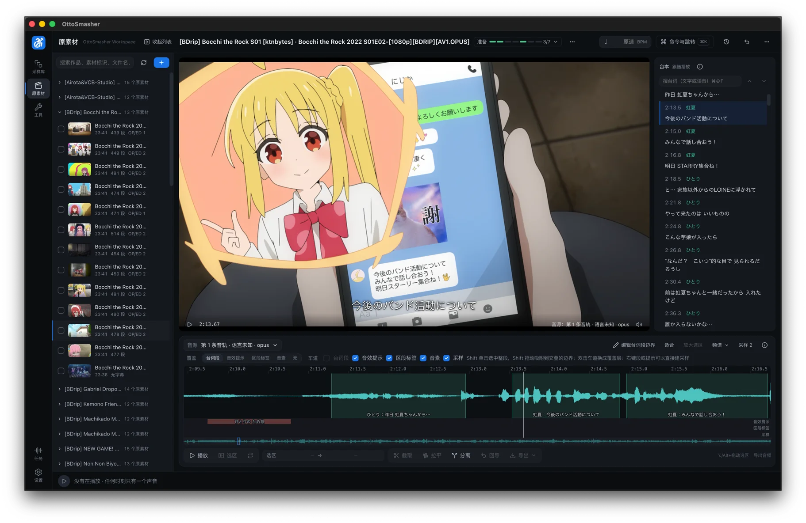
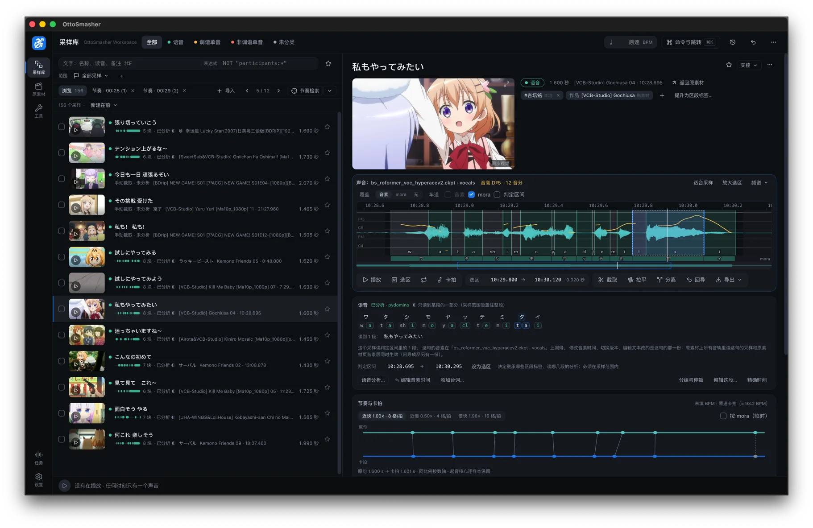
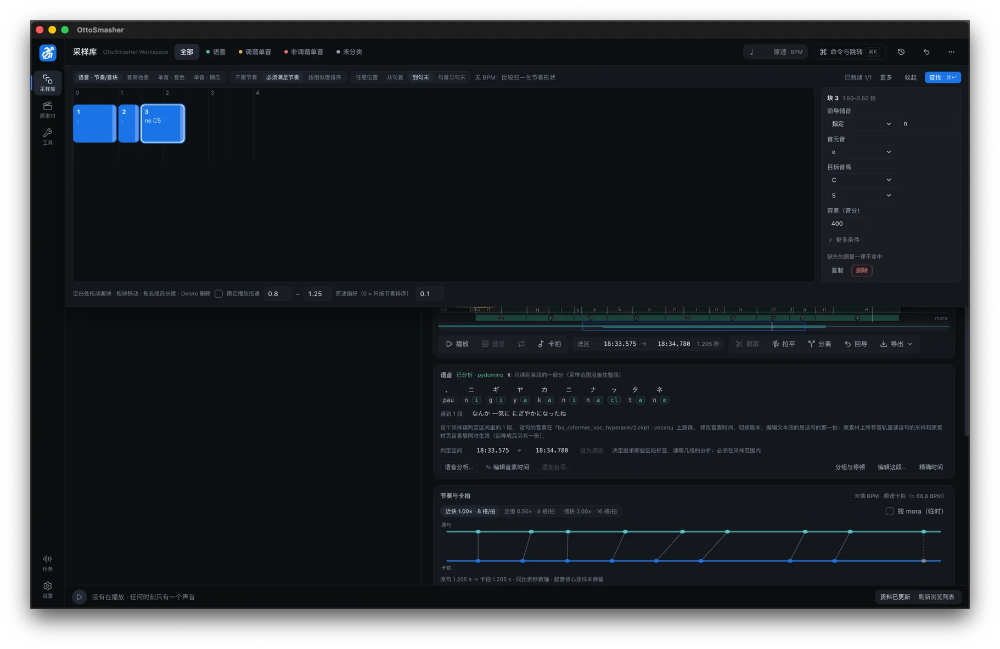
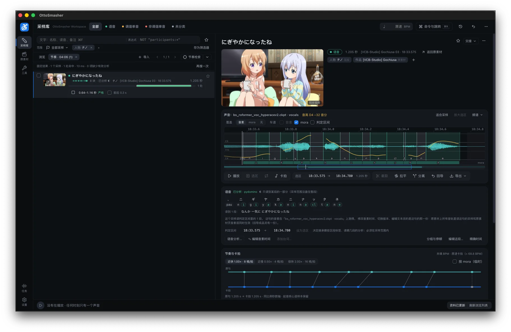
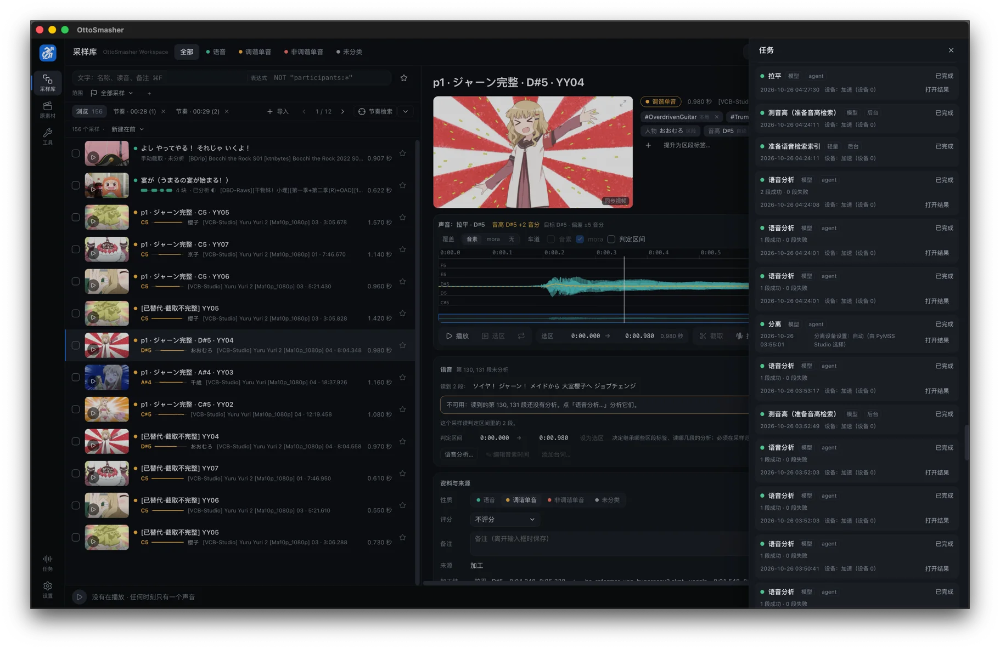
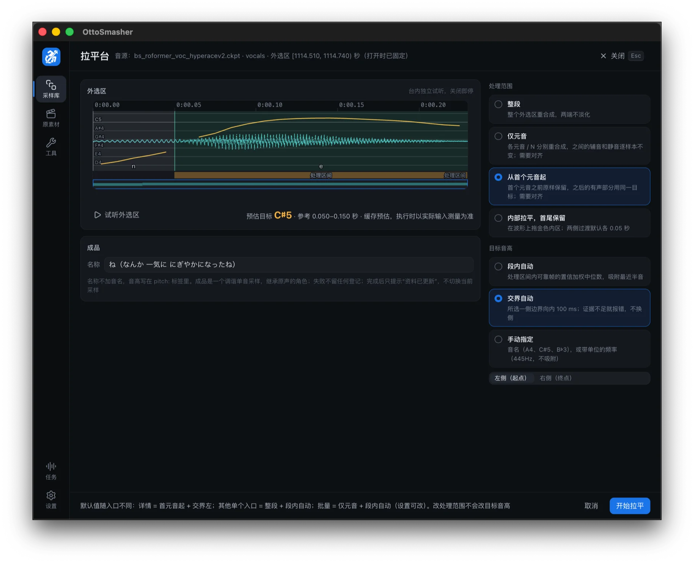

<p align="center">
  
</p>

<h1 align="center">OttoSmasher</h1>

<p align="center">本地运行的音 MAD 素材工作站</p>

<p align="center">
  <a href="https://github.com/Axolyz/OttoSmasher/releases"></a>
  <a href="LICENSE"></a>
</p>

OttoSmasher 是一个音 MAD 素材工作站。它可以从番剧、视频、游戏语音和音效包中查找台词和音效，完成截取、人声分离、拉平和卡拍，并支持按节奏或音高检索整个素材库，最后把结果交给 REAPER 或视频软件。Claude Code、Codex 等 agent 也可以通过命令行操作它，完成洗字幕、挑台词这类需要判断的工作。

**当前项目仍处于早期版本，Windows 版为预览版，可能存在 BUG 或不稳定的问题。**

下载：[发布页](https://github.com/Axolyz/OttoSmasher/releases)（macOS Apple 芯片、Windows 10 / 11 x64）。安装步骤见[安装](#安装)。

*OttoSmasher is a local desktop workstation for otoMAD material. Review, cut, separate, flatten, beat-stretch and search lines and sound effects from anime, videos, game voices and sample packs, then hand them off to REAPER and video editors. The interface is in Simplified Chinese and English; speech analysis supports Japanese. LLM agents such as Claude Code and Codex can operate it through the `otto` command line.*

<p align="center">
  
</p>

## 工作流推荐

我们推荐的工作流是：

1. 按作品整理素材文件夹，把同名字幕放在视频旁边（见[文件夹和字幕的写法](docs/user/reference.md)）
2. 在 OttoSmasher 中登记文件夹并导入字幕
3. 分离人声，并设为默认人声轨（可选，需要另外安装 PyMSS Studio）
4. 把台词批量建成采样，并进行语音分析
5. 按节奏或音高检索采样，按 BPM 卡拍试听
6. 把结果复制到 REAPER，或导出 WAV、视频片段

当然，OttoSmasher 也支持其他用法：

1. 一边看一边手动挑选台词，不批量建采样
2. 没有字幕的视频也可以截取、分离、拉平和按音高检索
3. 导入音效包和乐器单音，按音高、瞬态或音色筛选

第一次使用可以跟着[入门教程](docs/user/tutorial.md)走一遍。完整说明见[用户说明](docs/user/README.md)。

## 配合 agent 使用

Claude Code、Codex 等能在本机运行命令的 agent 可以通过命令行 `otto` 操作 OttoSmasher，调用的是和界面相同的功能。应用负责存资料、分离、分析、检索和导出这些确定的工作；洗字幕、对轴、挑台词、挑音色、编排 rap 这些需要判断的工作可以交给 agent。

把这段话发给 agent，后面接上任务即可：

```
请用命令行 otto 操作我电脑上的 OttoSmasher：先运行 otto status 和 otto guide，应用没开就运行 otto open。
任务：……
```

- **可以查看和撤回**：agent 对资料的修改按会话记录，可以在应用的操作历史中查看，也可以整批撤回。新建的采样和音轨不能撤回，可以删除。
- **危险操作需要确认**：删除原素材这类撤销不了的操作，需要你在应用里点击允许才会执行。
- **能“听”声音**：接上音频工具 audio-mcp 后，agent 可以看频谱、量响度、做带时间的转写。
- **做法可以修改**：洗字幕、对轴、按说话人分组等内置做法都是工作区里的文件，可以直接修改，也可以添加自己的做法。

详细说明见[让 agent 操作 OttoSmasher](docs/user/agents.md)。

## 功能介绍

| 功能 | 说明 |
|---|---|
| 原素材 | 只登记文件位置，不复制、不转码；按作品分组；字幕导入后成为台词段和音效提示 |
| 采样 | 可以在时间线上框选，也可以按台词、音效提示或整个文件批量创建；支持标签、星标和筛选器 |
| 语音分析 | 日语音素对齐；可以用用户辞典修正读音，也可以手动修改音素边界 |
| 卡拍 | 按 BPM 对齐每个音头，保留音高和起音，只伸缩中间部分 |
| 检索 | 画一串音块查找节奏和发音相近的台词；画音高块在采样或整条音轨上查找 |
| 处理 | 拉平为单一音高；调用另外安装的 PyMSS Studio 分离人声 |
| 交接 | 导出 WAV 和视频片段；拖出到 DAW；复制到 REAPER 时带拉伸标记，删除标记即可回到原声 |
| 独立化 | 把需要保留的采样存为无损切片，之后可以删除整集原素材以节省磁盘 |

## 截图

采样库：左侧是采样列表，右侧是画面、波形、语音分析和卡拍对照。



| 节奏检索：画音块 | 检索结果：命中的位置与匹配度 |
|---|---|
|  |  |
| **任务抽屉**：分析、分离、拉平都在后台排队 | **拉平台**：选择范围和目标音高 |
|  |  |

## 系统要求

| | |
|---|---|
| 系统 | macOS 14 或更新（Apple 芯片）；Windows 10 / 11 x64（预览版，支持 DirectML 显卡加速，没有独显时使用 CPU） |
| 磁盘 | 应用约 1.2 GB（含模型）；约 4000 个采样时工作区附带数据约 4 GB，不含原素材 |
| 语言 | 界面支持简体中文和英文；语音分析目前只支持日语 |
| 可选 | 人声分离需要 [PyMSS Studio](https://github.com/pymss-project/pymss-studio/releases) |

## 安装

### macOS

1. 从[发布页](https://github.com/Axolyz/OttoSmasher/releases)下载 `OttoSmasher-<版本>-macos-arm64.zip`，并核对发布说明中的 SHA-256：
   ```
   shasum -a 256 OttoSmasher-*.zip
   ```
2. 解压后把 `OttoSmasher.app` 拖入“应用程序”。
3. 第一次打开前，在终端运行：
   ```
   xattr -dr com.apple.quarantine /Applications/OttoSmasher.app
   ```
   应用没有经过 Apple 公证，不运行这条命令会被 macOS 拦下。每次下载新版本后都需要重新运行。也可以在被拦下后，到“系统设置 → 隐私与安全性”点击“仍要打开”。

### Windows（预览版）

1. 从[发布页](https://github.com/Axolyz/OttoSmasher/releases)下载 `OttoSmasher-<版本>-windows-x64.zip`，用 `Get-FileHash OttoSmasher-*.zip` 核对 SHA-256。
2. 解压到任意文件夹，运行 `OttoSmasher.exe`。安装包没有签名，SmartScreen 拦下时点击“更多信息 → 仍要运行”。

## 常见问题

### 数据存放在哪里？

都在工作区中，默认是“文稿”下的 `OttoSmasher Workspace`。生成的音轨和导出文件在其中的 `Library/`。

### 更新会丢失数据吗？

不会。替换应用不会改动工作区。新版本需要升级数据库时，会先自动备份到 `Data/Backups/`。

### 会复制或修改我的原素材吗？

不会。OttoSmasher 只记录原素材的位置，也不会删除磁盘上的原始文件。

### 需要联网吗？

应用本身不需要。发布版自带全部模型；人声分离的模型由 PyMSS Studio 下载。如果让 agent 使用云端模型，它读到的台词和音频可能会离开本机，是否这样使用由你决定。

### 不分离人声能用吗？

可以。不过分离后语音分析的对齐会更准。

### 没有日语台词能用吗？

可以。语音分析目前只支持日语，但截取、分离、拉平、音高检索和导出都不受影响。

## 问题反馈

问题和建议请[提交 issue](https://github.com/Axolyz/OttoSmasher/issues)，并附上系统版本、复现步骤和工作区 `Data/Logs/` 下的相关日志。

另外，按照现在项目的成熟度，批量裁切拼字的音素、乃至半自动生成 UTAU 音源都可以轻松实现，但开发者不熟悉人力 VOCALOID 工作流所以不知道怎么做到软件里，如果你是一位熟悉上述工作流的音 mader，非常欢迎提这方面的开发思路。

## 致谢

本项目使用了 [pydomino](https://github.com/DwangoMediaVillage/pydomino)、[pyopenjtalk-plus](https://github.com/tsukumijima/pyopenjtalk-plus)、[tsqyomi](https://huggingface.co/tsukumijima/tsqyomi-models)、[FCPE](https://github.com/CNChTu/FCPE)、[HiFiShifter](https://github.com/ARounder-183/HiFiShifter)、[OpenVPI](https://github.com/openvpi) 的 PC-NSF-HiFiGAN、[Rubber Band](https://breakfastquay.com/rubberband/)、[mpv](https://mpv.io/)、[FFmpeg](https://ffmpeg.org/)、[ONNX Runtime](https://onnxruntime.ai/)、[Electron](https://www.electronjs.org/)、[React Aria](https://react-spectrum.adobe.com/react-aria/) 和 [PyMSS Studio](https://github.com/pymss-project/pymss-studio)。完整清单和各自的许可见 [THIRD_PARTY.md](docs/THIRD_PARTY.md)。

## 许可

OttoSmasher 基于 [GPL-3.0-or-later](LICENSE) 发布，可以自由使用、修改和再分发；再分发时需要同样以 GPL 发布并提供源码。本程序不提供任何担保。

- 随包的第三方组件各有许可，相关文件在发布包的 `licenses/` 中。
- 模型权重是单独的组件。对齐、读音预测、音高模型为 MIT；拉平声码器 PC-NSF-HiFiGAN 是 CC BY-NC-SA 4.0，只能用于非商业用途，商业再分发前请删除 `Contents/Resources/models/flatten/`。

## 参与开发

该部分内容为开发者提供，普通用户可以跳过。

- 从源码运行、测试、打包：[DEVELOPMENT.md](docs/DEVELOPMENT.md)
- 开发约定（人和 AI 代理通用）：[AGENTS.md](AGENTS.md)
- 系统结构：[ARCHITECTURE.md](docs/ARCHITECTURE.md)
- 现行决定：[DECISIONS.md](docs/DECISIONS.md)，改变既定行为前请先开 issue 讨论
- 计划：[ROADMAP.md](docs/ROADMAP.md)
