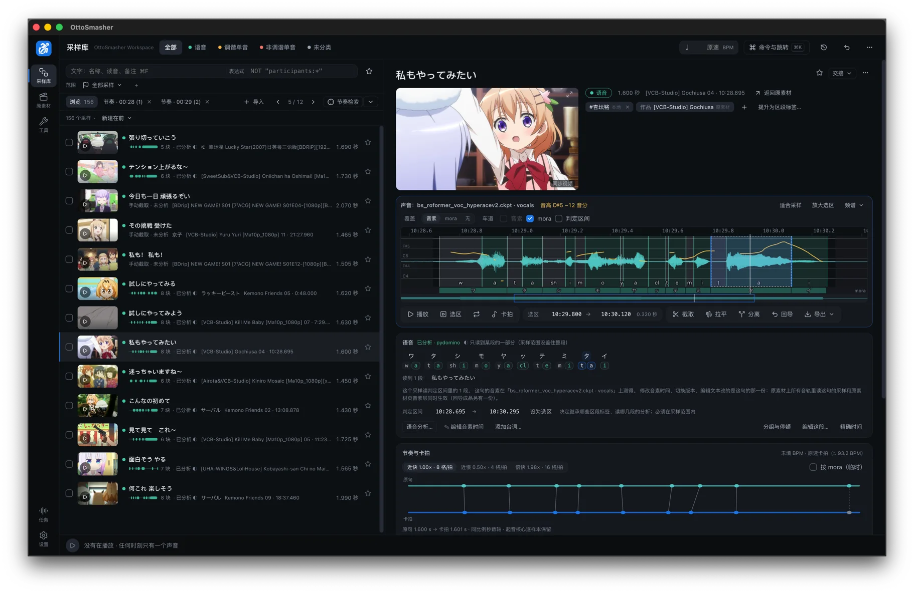
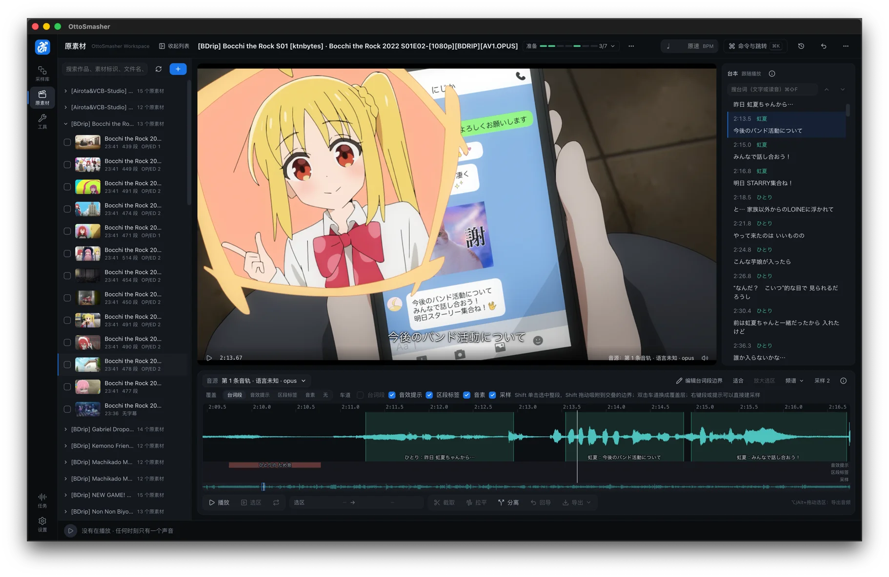
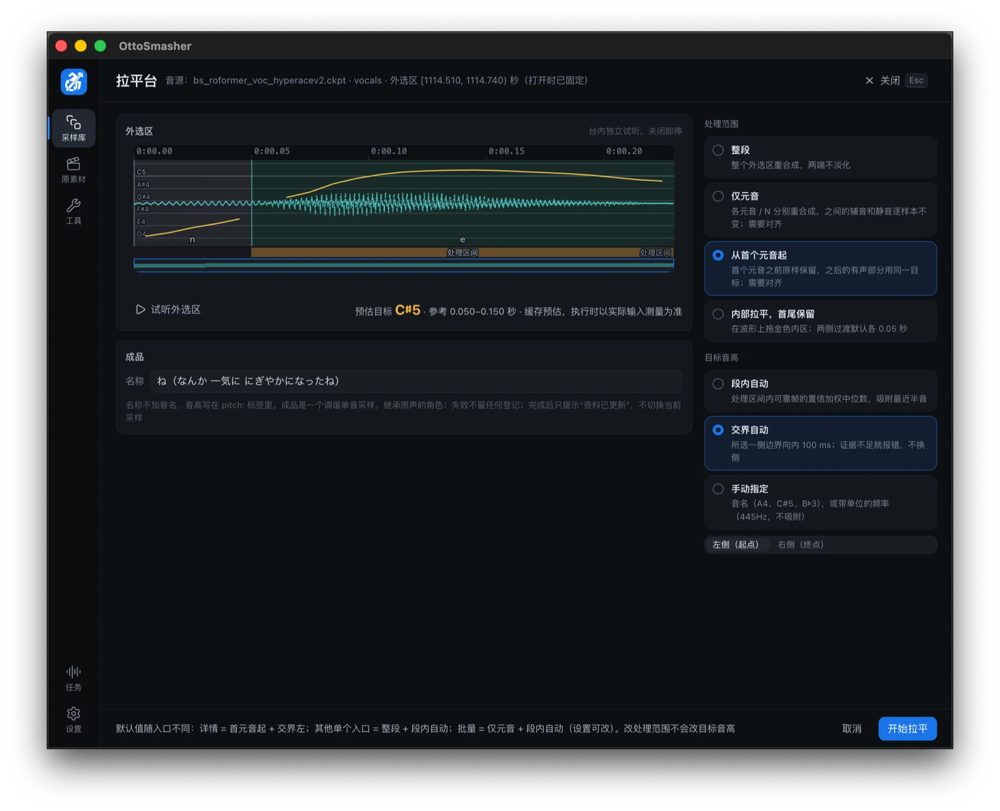
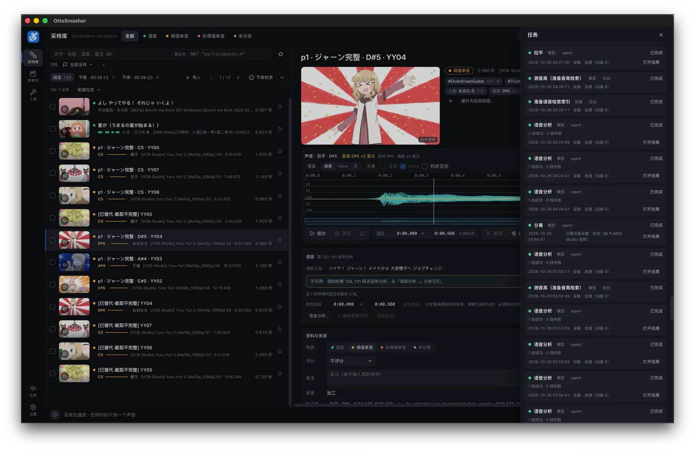
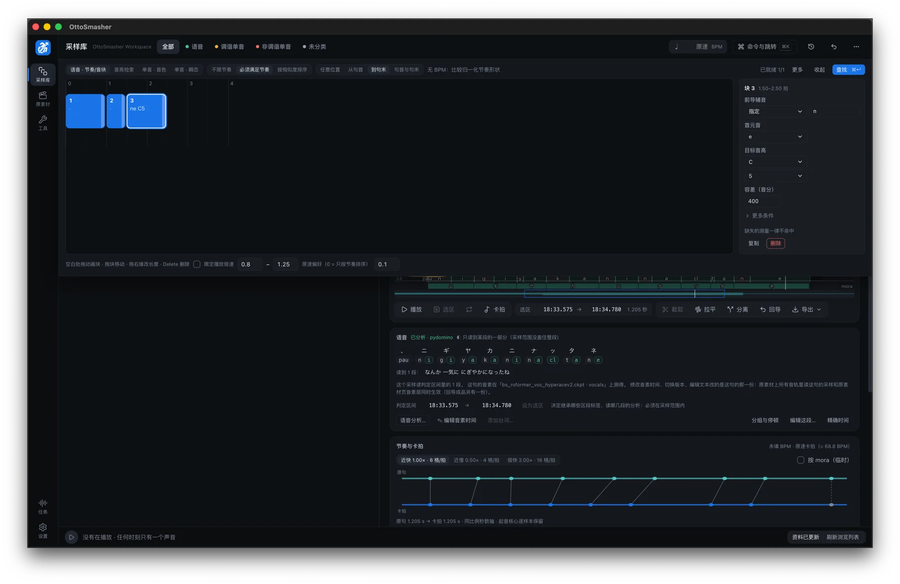
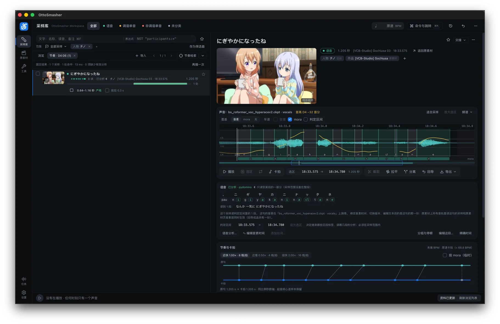

<p align="center">
  
</p>

<h1 align="center">OttoSmasher</h1>

<p align="center">本地运行的音 MAD 素材工作站</p>

<p align="center">简体中文 | <a href="README.en.md">English</a></p>

<p align="center">
  <a href="https://github.com/Axolyz/OttoSmasher/releases"></a>
  <a href="LICENSE"></a>
</p>

OttoSmasher 是一个音 MAD 素材工作站。它可以从番剧、视频、游戏语音和音效包中统一管理台词、采样和音效，一站式完成截取、人声分离、拉平和卡拍(卡节奏)，并支持按节奏或音高检索整个素材库，最后把结果交给 DAW 或视频软件。Claude Code、Codex 等 agent 也可以通过命令行操作它，完成洗字幕、挑台词、选音色这类需要判断的工作；不接 agent，它也是一个能独立使用的素材工作站。

一整季台词可以批量建成采样，每条只记录原音轨上的一段区间。做新作品时，可以回到同一个库里按角色、台词、节奏或音高找素材，回原片听前后文，也可以把同一条采样加入多个项目。

OttoSmasher 不生成音乐，也不替你创作。它负责让素材处理和素材管理少一些重复劳动，选什么、怎么编、想表达什么，仍然由你决定。

**当前项目仍处于早期版本，可能存在 BUG 或不稳定的问题。**

开发者主要在 macOS 上使用；Windows 只做过大致的实机测试，仍可能有少量 bug。

下载：[发布页](https://github.com/Axolyz/OttoSmasher/releases)（macOS Apple 芯片、Windows 10 / 11 x64）。安装步骤见[安装](#安装)。

<table>
  <tr>
    <td width="50%"></td>
    <td width="50%"></td>
  </tr>
</table>

## 工作流推荐

对动画、人声视频这类语音素材的推荐工作流是：

0. (可选) 字幕还没整理好时，先[预处理字幕](docs/user/how-to.md#预处理字幕)
1. 按作品整理素材文件夹，把同名字幕放在视频旁边（见[文件夹和字幕的写法](docs/user/reference.md)）
2. 在 OttoSmasher 中登记文件夹，同名字幕会自动关联，再点一下导入
3. 分离人声，并设为默认人声轨（需要另外安装 PyMSS Studio 并手动下载模型）。背景不干净的素材如果跳过这一步，后面的语音分析基本不能用
4. 把台词批量建成采样，并进行语音分析
5. (可选) 进行若干检索
6. 把结果拖到 DAW，或导出 WAV、视频片段

当然，OttoSmasher 也支持其他用法：

1. 一边审阅原片一边手动挑选中意的台词，不批量建采样
2. 不分离人声、[没有字幕](docs/user/how-to.md#处理没有字幕的视频)乃至非日语的素材也可以截取、分离、拉平和按音高检索
3. 导入游戏语音包、音效包乃至乐器单音，按音高、瞬态或音色筛选
4. 想让 agent 帮你处理素材？见 [OttoSmasher Harness](#配合-llm-agent-使用ottosmasher-harness)。

第一次使用请看[入门教程](docs/user/tutorial.md)。完整说明见[用户说明](docs/user/README.md)。


## 功能介绍

### 原片阅览

从字幕导入台词时间戳和说话人（可选），在原片上快速阅览和导航。台词可以按文字或读音搜索，也能跨集找。在整片分离之后，可以切换到人声轨或伴奏等模型输出的音轨阅览，也能直接从一句台词建采样，采样名默认用台词。

一整季的台词也可以批量建采样，已标出的 OP、ED 自动跳过；还可以按音效提示或整个文件批量建。

### 素材加工

PyMSS 模型处理（如人声分离）、截取片段、音高拉平、回导四种加工方式，可以在处理之后的采样上再次处理，自由组合成加工链。你再也不用为了处理采样开四百个软件导出八百个文件打军体拳了。

- 保留原片时间映射的采样可以同步原画面，在采样和原片间双向导航，也可以从详情区查看加工链、打开相关采样。
- 采样可以直接拖进 DAW，也能导出原声或卡拍后的 WAV；有画面的采样还能导出对应的视频片段。
- 整片 PyMSS 处理的结果可以像原片自带的音轨一样使用。把分离出的人声设为默认人声轨，之后从台词建采样就可以用它做语音分析。一次分离，反复用，一劳永逸。
- 截取和建采样只记录声音和画面对应的区间，不会为每个采样另存一份原文件。分离、拉平和回导会存新的音频。你再也不用被一堆截下来的采样把磁盘挤爆了。
- 整集不想留了，但有几条采样舍不得删？用[「独立化」](docs/user/how-to.md#省磁盘)只存需要的无损音频和画面切片。移走原片后，这些采样还能照常试听和导出，只是不能回去看前后文了。
- 拉平可以只拉元音、也可以保留首尾只拉中间，目标音高还能手动指定音名。

| 拉平：选择范围和目标音高 | 任务抽屉：分析、分离、拉平都在后台排队 |
|---|---|
|  |  |

### 标签化的采样管理

所有采样在结构化采样库集中有序管理，有同步画面的可以直接看原画面。你再也不用对着一堆莫名其妙的采样文件和中间产物焦头烂额了。

- 采样可以自动继承作品、说话人和原片区段上的标签，也能自己加本地标签、打星标。
- 提供项目标签功能，可以只看当前工程需要的采样；同一条采样也可以加入多个项目。

### 语音分析

日语台词支持音素级对齐，能看到每个辅音、元音落在哪里，也能查看音高和相对响度。这是下面音块和节奏检索的基础。边界有偏差可以手动修，同一句台词在不同音轨上的采样共用修正结果。

### 音块检索

想找一个拖得够长、音高又稳的「あ」做 Lead 采样？在节奏检索里画一个音块，填上首元音、原声时值下限和音高波动上限，就能在分析过的采样里找来试听。

### 智能卡拍

填个 BPM，就能把台词里元音或拨音的起音对到拍点上试听或导出。算法会尽量保住素材原有的节奏。把做过语音分析的采样复制到 REAPER，音头会自动挂好可编辑的拉伸标记。可以带卡拍效果，也可以只打标记、保留原节奏。

### 节奏检索

在格子上把所需的语音节奏画出来，让软件去库里找哪句话念起来能对上。每个音块还能进一步指定辅音、元音、音高和响度等。

| 画音块并设置条件 | 查看命中的位置与匹配度 |
|---|---|
|  |  |

### 音高检索

去采样库甚至整条音轨里按音高搜索命中的片段，还可以忽略八度，原音系特攻。

### 回导

软件内部不支持的声音处理，在外部做完可以把声音回导到原位置，原来的画面和区段标签还能接着用。

### Agent 联动和 Harness

配合 LLM Agent使用。可以直接跟 Codex、Claude Code 等说要求，让它们找台词、做分析或找采样。结果会同步到界面，方便你随时试听和接手。支持撤销的修改可以逐条或按会话撤回；不可逆的危险操作默认需要你批准才执行。

- 洗字幕、对轴、标说话人这类复杂任务有内置 skill，可以自行修改，也可以在 playbook 里加自己的要求。接上 audio-mcp 后，agent 还能看频谱、量响度、做带时间戳的转写。
- Skill 里自带图一乐的**都爆模式**（[`picking-instruments`](docs/user/agents.md#修改-skill-和约定)）：给定 MIDI 和素材，让 agent 找采样、做试听（效果比较垃圾，仅供娱乐）。

### 人力 VOCALOID 工作流

按照现在项目的成熟度，批量裁切拼字的音素、乃至半自动制作 UTAU 音源都有探索空间，但开发者不熟悉人力 VOCALOID 工作流，不知道怎么做到软件里。如果你是一位熟悉上述工作流的音 mader，非常欢迎提这方面的开发思路。

## 配合 LLM agent 使用


这个项目非常适合作为大模型辅助制作音 MAD 的素材库和工具库基座。采用 human-in-the-loop 的设计思路，通过 CLI + skill 的 Harness，开放了几乎全部能力和数据接口让 agent 调用。可以大致理解为接入的 LLM 能调用所有你能看到的数据，能执行你在这个软件里能执行的所有操作 (高危不可逆的默认需授权)，所以开发潜力比较大。
### 开场白

把下面的话发给 agent，后面接上 prompt 即可：

```
请用命令行 otto 操作我电脑上的 OttoSmasher：先运行 otto status 和 otto guide，应用没开就运行 otto open。
任务：……
```

了解更多接入方式，见[让 agent 操作 OttoSmasher](docs/user/agents.md)。

### Prompt实例

下面这些 Prompt 仅供参考，如果有好的使用例欢迎提交上来：
一些已验证过效果较好的使用例：
- 找一些あかり说的中二台词建立采样并打上标签，最好是有实际意义的短句
- 找一些やす子的 C4 左右的稳定长嘶吼音，要注意对嘶吼音我们的默认音高检测常常是失效的，你要看频谱逐个判断
- 对照一下 midi 文件，在 14 小节把上面的嘶吼音音高大致对到这个小节的和弦音上，注意不要使用自带的拉平，那样会损失嘶吼的质感，你可以使用 rubber band 或者直接重采样整体升降调
- 预处理一下【文件目录或素材目录】的字幕。字幕源是【字幕路径】，目标片源是【目标片源】(会自行调用内置的 preparing-subtitles skill, 一次性完成洗字幕、对轴、标说话人等所有预处理工作)
- 这是 midi 文件，结合 midi 的乐器特点给各个轨道找一些采样候选并加入本项目，你要用频谱分析音色
- 给我找若干个鼓采样候选，尽量找低频下潜足的，必要时可以采用一些轻度处理手段，例如音量包络，降调或者一堆打击音叠一起，你要尽量找真实采样(也就是非画外音非 bgm 的，动画里发出的真实声音)，必要时可以用对应的画面辅助核对 (ps. 其实理论上 pymss 里 bandit 三轨分离的 effect 轨道就是用来干这个的, 但是那玩意效果有点垃圾, 分出来的还会缺频, 不过可以当个减少筛选范围的辅助信息)
- 我懒得自己弄了，把这一堆字幕和片整理一下走默认全套登记流程
- 看一眼  Reaper/Hifishifter 工程文件，导出用到的全部采样对应的视频文件，并给出一个时间映射表，方便后续的视频制作
一些验证过效果比较垃圾的使用反例：
- 这是 midi 文件，采样库里选些语音给我编排一下 rap (抽卡, 就算能调用节奏检索大概率也会很难听)
- 这是 midi 文件，给各个轨道找一个采样，之后直接生成总音频文件给我 (抽卡, coding llm 绝大部分没有原生音频模态，就算接上 daw 的 mcp 也几乎不会混音，而且读频谱判断音色准确率并不会非常高, 大概率很垃圾)

### 其他要求

系统方面，MacOS 是最为推荐的用于 Agent 接入的操作系统，但 Windows 也可用。需要注意的是 Windows 下很多 Agent 工具为了运行 `otto` 命令只能开 Full Access 模式，不然会撞沙箱。

截至 2026-11-8，GPT 6.1 Sol + Codex 是本项目推荐的最优 Agent 配置，也是作者实际工作时采用的配置。如果只想使用国内模型，请至少使用 DeepSeek v4.1 flash 或 GLM 5.3 Flash 这一智力等级的模型 + Coding Agent 工具。实测 DeepSeek Harness 的可用性在完成基础任务时已经很高，但是如字幕预处理以及采样选择的这类需要判断和组合工具的复杂任务效果不能保证，在这类大型任务中不知为何蓝色大肥鱼的指令遵循只能用悲剧来形容，作者已经针对性优化过一轮指令系统，但仍然不能保证效果像 GPT 一样好。

## 系统要求

|      |                                                                                                                                                                                                                                                             |
| ---- | ----------------------------------------------------------------------------------------------------------------------------------------------------------------------------------------------------------------------------------------------------------- |
| 系统   | macOS 15 或更新（Apple 芯片）；Windows 10 / 11 x64（支持 DirectML 显卡加速，没有独显时使用 CPU）                                                                                                                                                                                    |
| 磁盘   | 应用约 1.2 GB（含模型）；40 集动画建立全量采样的情况下各类数据和文件占用约 4GB (不含原素材)                                                                                                                                                                                                      |
| 语言   | 界面支持简体中文和英文；语音分析目前只支持日语                                                                                                                                                                                                                                     |
| 人声分离 | 需要另装 PyMSS Studio，**已验证可用的 PyMSS Studio 版本：[v0.1.0](https://github.com/pymss-project/pymss-studio/releases/tag/v0.1.0) 和 [v0.1.1](https://github.com/pymss-project/pymss-studio/releases/tag/v0.1.1)。其他版本不保证可用。** 安装和模型选择见[分离人声](docs/user/how-to.md#分离人声)。 |

## 安装

### macOS

1. 从[发布页](https://github.com/Axolyz/OttoSmasher/releases)下载 `OttoSmasher-<版本>-macos-arm64.zip`，并核对发布说明中的 SHA-256：
   ```
   shasum -a 256 OttoSmasher-*.zip
   ```
2. 解压后把 `OttoSmasher.app` 拖入“应用程序”。
3. 第一次打开前，在终端运行：
   ```
   xattr -dr com.apple.quarantine /Applications/OttoSmasher.app
   ```
   应用没有经过 Apple 公证，不运行这条命令会被 macOS 拦下。每次下载新版本后都需要重新运行。也可以在被拦下后，到“系统设置 → 隐私与安全性”点击“仍要打开”。

### Windows

1. 从[发布页](https://github.com/Axolyz/OttoSmasher/releases)下载 `OttoSmasher-<版本>-windows-x64.zip`，用 `Get-FileHash OttoSmasher-*.zip` 核对 SHA-256。
2. 解压到任意文件夹，运行 `OttoSmasher.exe`。安装包没有签名，SmartScreen 拦下时点击“更多信息 → 仍要运行”。

## 常见问题

### 数据存放在哪里？

都在工作区中，默认是“Documents”下的 `OttoSmasher Workspace`。生成的音轨和导出文件在其中的 `Library/`。

### 更新会丢失数据吗？

不会。替换应用不会改动工作区。新版本需要升级数据库时，会先自动备份到 `Data/Backups/`。

### 会复制或修改我的原素材吗？

不会。OttoSmasher 只记录原素材的位置，也不会删除磁盘上的原始文件。

### 需要联网吗？

应用本身不需要。发布版自带内置功能所需的模型；人声分离的模型由 PyMSS Studio 下载。不过如果让使用云端模型的 agent 接入本应用，它读到的台词和音频可能会被上传，是否这样使用由你决定。

### 为什么要另外安装 PyMSS Studio？

Studio 自带图形界面，下载、切换和管理模型更方便。你可以按素材选模型、按硬件选推理环境，不用等 OttoSmasher 发新版。

人声分离计算量大，有时需要硬件加速。如果把支持 CUDA 的 PyTorch 运行环境一起打包，会让 OttoSmasher 的发布包超过 2 GB。把分离交给 Studio，可以让 OttoSmasher 保持相对轻量；而且如果不做分离就不用安装这套环境。

### 不分离人声、没有字幕或者素材不是日语，能用吗？

能用，基础功能都不受影响：登记和播放、在时间线上截取、人声分离、整段拉平、音高检索、标签整理，以及导出 WAV 和视频片段。

但很多高级功能依赖干净的人声和音素对齐，受到的影响可能很大：

| 情况     | 受影响的功能                                                                                                                                                               |
| ------ | -------------------------------------------------------------------------------------------------------------------------------------------------------------------- |
| 没有分离人声 | 语音分析可以直接跑在原混音上，但有背景音乐或音效时，音素对齐的错误率会大幅上升，结果基本不能用。卡拍、节奏检索和 REAPER 的拉伸标记都建立在对齐结果上，会跟着出错。音高测量也容易被伴奏干扰，进而影响音高检索和自动定音。agent 的对轴、拆分多人字幕和声纹分组同样需要干净的人声。原本就是干声的素材（如游戏语音）不用分离。 |
| 没有字幕   | 没有台词段，就不能从台词批量建采样、搜索台词、按人物筛选，也做不了语音分析，因此卡拍、节奏检索、REAPER 的拉伸标记和只拉平元音都用不了。可以手动输入台词，或自行用语音识别工具转写并导入 SRT。见[处理没有字幕的视频](docs/user/how-to.md#处理没有字幕的视频)。 |
| 不是日语   | 字幕可以导入，也可以按文字搜索和批量建采样。但语音分析目前只支持日语，所以卡拍、节奏检索、REAPER 的拉伸标记和只拉平元音同样用不了。agent 也用不了应用的对齐和读音分析能力。                                                                         |

## 已知问题

- Windows 下部分 agent（如 DeepSeek Harness）的受限沙箱会拦住本地命名管道连接，提示 Access denied。使用 Codex 以外的 LLM agent 时，目前建议在宿主中开启 **Full Access**。
- audio-mcp 首次转写需要下载模型（turbo 约 1.6 GB），需有合适的网络环境。CPU 转写长音频较慢，可以先提取短片段再分析。
- Windows 下 Alt 拖到资源管理器需先松开 Alt 再放。
- 在 macOS 上把 WAV 拖进 DAW 时，接收软件通过系统接口读取路径后，可能会把 `が` 读成 `か` 加一个组合浊点。OttoSmasher 导出的 WAV 文件名保留合成写法，实际表现取决于接收软件。
- 更具体的未结事项见[路线图](docs/ROADMAP.md)。

## 问题反馈

问题和建议请[提交 issue](https://github.com/Axolyz/OttoSmasher/issues)，并附上系统版本、复现步骤和工作区 `Data/Logs/` 下的相关日志。

## 致谢

本项目使用了 [pydomino](https://github.com/DwangoMediaVillage/pydomino)、[pyopenjtalk-plus](https://github.com/tsukumijima/pyopenjtalk-plus)、[tsqyomi](https://huggingface.co/tsukumijima/tsqyomi-models)、[FCPE](https://github.com/CNChTu/FCPE)、[HiFiShifter](https://github.com/ARounder-183/HiFiShifter)、[OpenVPI](https://github.com/openvpi) 的 PC-NSF-HiFiGAN、[Rubber Band](https://breakfastquay.com/rubberband/)、[mpv](https://mpv.io/)、[FFmpeg](https://ffmpeg.org/)、[ONNX Runtime](https://onnxruntime.ai/)、[Electron](https://www.electronjs.org/)、[React Aria](https://react-spectrum.adobe.com/react-aria/) 和 [PyMSS Studio](https://github.com/pymss-project/pymss-studio)。完整清单和各自的许可见 [THIRD_PARTY.md](docs/THIRD_PARTY.md)。

## 许可

OttoSmasher 基于 [GPL-3.0-or-later](LICENSE) 发布，可以自由使用、修改和再分发；再分发时需要同样以 GPL 发布并提供源码。本程序不提供任何担保。

- 随包的第三方组件各有许可，相关文件在发布包的 `licenses/` 中。
- 模型权重是单独的组件。对齐、读音预测、音高模型为 MIT；拉平声码器 PC-NSF-HiFiGAN 是 CC BY-NC-SA 4.0，只能用于非商业用途，商业再分发前请删除 `Contents/Resources/models/flatten/`。

## 参与开发

该部分内容为开发者提供，普通用户可以跳过。

- 从源码运行、测试、打包：[DEVELOPMENT.md](docs/DEVELOPMENT.md)
- 开发约定（人和 AI 代理通用）：[AGENTS.md](AGENTS.md)
- 系统结构：[ARCHITECTURE.md](docs/ARCHITECTURE.md)
- 现行决定：[DECISIONS.md](docs/DECISIONS.md)
- 计划：[ROADMAP.md](docs/ROADMAP.md)

## 友情链接

- [HiFiShifter](https://github.com/ARounder-183/HiFiShifter)（我要在这里催更一下拉伸标记功能，将在更新后第一时间适配）
- [HachiShifter](https://github.com/openhachimi/HachiShifter)（之后对人力 VOCALOID 工作流的适配会以这个项目为主要适配对象）

